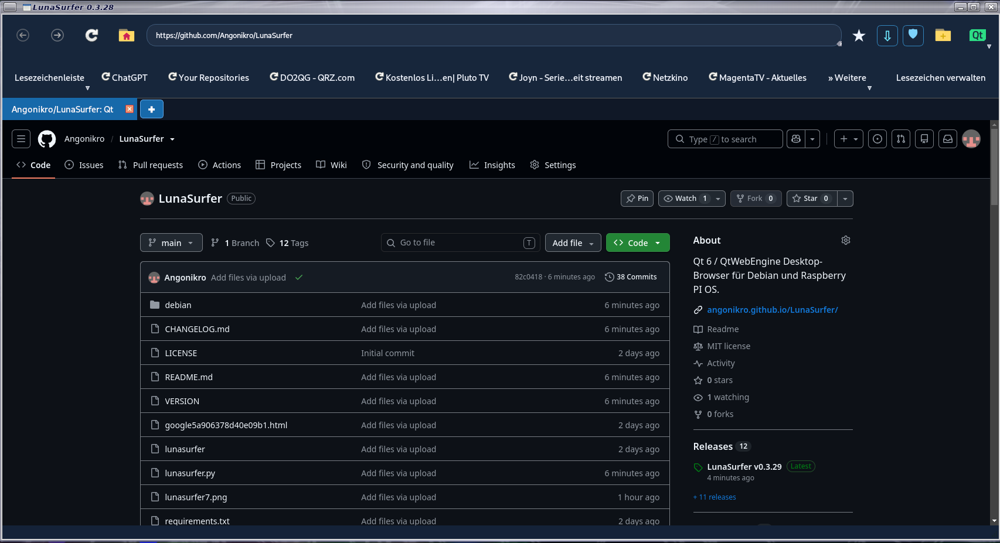

# LunaSurfer 0.3.43

Qt 6 / QtWebEngine Desktop-Browser für Debian und Raspberry PI OS.



[Github Seite](https://github.com/Angonikro/LunaSurfer/)

## Funktionen

- Tabs, Adress-/Suchleiste, Navigation und Startseite
- Einstellungen öffnen wie bei Chromium in einem eigenen Browser-Tab statt in einem separaten Dialog; vorhandene Browser-Tabs bleiben erhalten
- Überarbeitetes dunkles Einstellungsdesign mit stimmigen Hintergründen, Eingabefeldern und Bedienelementen
- Große, gut erkennbare Symbole in der oberen Leiste
- **★ Lesezeichen-Stern direkt neben der Adressleiste**
- Lesezeichenleiste direkt unter der Adressleiste, ähnlich Chromium
- Lesezeichen und Verlauf werden dauerhaft gespeichert
- Lesezeichenleiste kann unter **Menü → Einstellungen** ein- oder ausgeblendet werden
- Lesezeichen können im standardmäßigen Chromium/Netscape-HTML-Format einschließlich Ordnerstruktur exportiert und aus einer Chromium-kompatiblen HTML-Datei importiert werden. Beim Zusammenführen werden doppelte URLs vermieden und die Lesezeichenleisten-Root korrekt behandelt.
- Kontextmenü der rechten Maustaste mit „Diese Seite durchsuchen…“ zum Suchen und Hervorheben von Begriffen auf der aktuell geöffneten Webseite; außerdem Seitenaktionen und Entwicklerwerkzeuge
- Entwicklerwerkzeuge mit F12, rechts angedockt und mindestens 590 px breit (ca. 15,6 cm); DOM-Inspektor, Konsole und Netzwerk je nach QtWebEngine-Version)
- Erweiterter Download-Manager mit Fortschritt, Prozent, Größe, Geschwindigkeit, Abbrechen, Datei/Ordner öffnen sowie Listen- und Dateilöschung
- Kleines Hinweisfenster, sobald ein Download vollständig abgeschlossen ist
- **+ Schaltfläche in der Tab-Leiste** zum schnellen Öffnen eines neuen Tabs
- Helles oder dunkles Webseiten-Design
- Separater Webseiten-Schwarzmodus mit schwarzen Hintergründen und heller Schrift; Bilder, Videos, Canvas und SVG bleiben farblich unverändert
- Unabhängige Einstellung für Webseiten-Lesbarkeit und Farbgebung
- Fünf unterschiedliche Designs
- Persistentes Browser-Profil und Cookies
- Widevine-Unterstützung, wenn das CDM auf dem System vorhanden ist
- In den Einstellungen kann gewählt werden, ob LunaSurfer Fenstergröße und Fensterposition beim Beenden speichern und beim nächsten Start wiederherstellen soll.
- Integrierter Adblocker mit fünf Stufen: Standard, Stark, Sehr stark, Super stark und Mega stark; inklusive eigener Blockiermuster und Whitelist
- Passwortmanager mit Argon2id-Schlüsselableitung, 128 MiB Speicherbedarf und automatischer Migration vorhandener PBKDF2-Tresore
- User-Agent-Verwaltung: Datenschutz-Standard, nativer QtWebEngine-User-Agent oder eigener User-Agent; Änderungen werden ohne Browserneustart übernommen
- Webseiten-Übersetzung über die Schaltfläche „文“: ganze Seiten in 12 Zielsprachen übersetzen und zur Originalseite zurückkehren (Google Übersetzer; Internetverbindung erforderlich)
- usw.

## Lesezeichen bearbeiten und verwalten

- Mit der **rechten Maustaste auf ein Lesezeichen in der Lesezeichenleiste oder im Menü „Weitere“** kannst du es öffnen, bearbeiten oder löschen.
- Unter **Menü → Lesezeichen verwalten** kannst du gespeicherte Lesezeichen öffnen, bearbeiten und löschen. Der Manager bietet eine aufklappbare Ordnerstruktur, Suche nach Namen und Adressen sowie Import und Export.

## Speicherorte

- Einstellungen: `~/.config/lunasurfer/`
- Browserdaten und Lesezeichen: `~/.local/share/lunasurfer/`
- Cache: `~/.cache/lunasurfer/`
- Downloads: `~/Downloads/`
- Download Verlauf `~/.local/share/lunasurfer/downloads.json`

## Abhängigkeiten (Debian 13)

Zusätzlich zu `python3-cryptography` wird `python3-argon2` für Argon2id benötigt. Vorhandene PBKDF2-Tresore werden beim ersten erfolgreichen Entsperren automatisch auf Argon2id umgestellt. Alte verschlüsselte Exporte mit PBKDF2 bleiben importierbar.

```bash
sudo apt update
sudo apt install python3 python3-pyside6.qtwidgets python3-pyside6.qtwebenginewidgets python3-pyside6.qtwebchannel python3-cryptography python3-argon2 xdg-utils
```

## Installation

```bash
sudo apt install ./lunasurfer_0.3.43_all.deb
```

## Start aus dem Quellcode

```bash
python3 -s lunasurfer.py
```

## Widevine / Pluto TV

Für DRM-Inhalte wie Pluto TV kann es auf manchen Debian-Systemen notwendig sein, den Widevine-Pfad für QtWebEngine zusätzlich in der Benutzerumgebung zu setzen. Wenn Widevine bei dir unter dem folgenden Pfad installiert ist:

`/opt/WidevineCdm/gmp-widevinecdm/latest/libwidevinecdm.so`

kannst du diesen Befehl ausführen:

```bash
echo 'export QTWEBENGINE_CHROMIUM_FLAGS="--widevine-path=/opt/WidevineCdm/gmp-widevinecdm/latest/libwidevinecdm.so"' >> ~/.profile
```

Danach bitte **ab- und wieder anmelden** oder den Rechner neu starten, damit die Einstellung aus `~/.profile` übernommen wird.

LunaSurfer setzt den Widevine-Pfad zusätzlich beim Start, wenn die CDM-Datei vorhanden ist. Die Einstellung in `~/.profile` kann dennoch hilfreich sein und wird beispielsweise auch von anderen QtWebEngine-Anwendungen wie Falkon verwendet.

Widevine ist nicht Bestandteil von LunaSurfer. Die Wiedergabe von DRM-Inhalten hängt von Widevine, QtWebEngine, den verfügbaren Codecs und dem jeweiligen Streaming-Dienst ab.

73 de DO2QG Andreas
